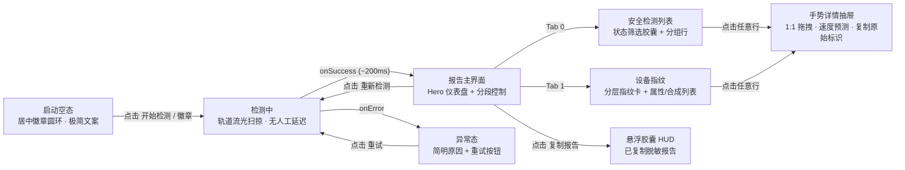

# RiskEngine Android Demo 产品 UI 重构设计文档

> **分支**：`feat/ui-redesign`  
> **设计参考**：Apple Design（*Designing Fluid Interfaces* / *Principles of Great Design* / *The Details of UI Typography*）、ChatGPT / Claude / Gemini Android 图标范式  
> **验证真机**：Google Pixel 6（`oriole` · Android 13 · 1080×2400 · 420 dpi）  
> **目标平台**：Android 11+（`minSdk 30` / `targetSdk 36`）

---

## 1. 现状诊断与重构目标（基于 Pixel 6 真机 ADB 实测）

通过 `adb screencap` 与 `uiautomator` 对原版 Demo 在 Pixel 6 上的启动态、报告态、指纹列表及系统桌面图标进行了完整审查，归纳出 6 个核心体验痛点：

| 维度 | 原版现状（真机实测问题） | 重构目标 |
| :--- | :--- | :--- |
| **App 图标** | 采用 3D 霓虹绿快门位图（`ic_launcher_artwork.webp`），自带圆角矩形底并填满 `<foreground>`，违反 66dp 圆形安全区；Android 13 `<monochrome>` 直接复用彩色位图导致主题图标糊成色块 | 重绘为纯几何矢量自适应图标：**极简盾形 + 四角星孔径**，参考 ChatGPT / Claude / Gemini 的纯几何留白范式，100% 适配圆形、圆角矩形、Squircle 与 Material You 单色主题 |
| **启动首屏与文案** | 顶部白条 + 一张孤立卡片，20:9 屏幕下方留白超 55%；卡片内堆叠“就绪 / 综合风险 / 准备就绪 / 本 Demo 为调试签名… / 尚未生成检测报告”和 0% 空进度条，充满“示例工程”感 | 垂直居中的品牌徽章圆环 + 极简 3 行信息（`设备安全检测` + 一句话副标题 + `开始检测` 胶囊主按钮），去除所有开发/示例口吻 |
| **结论卡信息冗余** | 同一卡片内 `高风险` 重复 2 次、`8/18` 重复 2 次，且卡片内套 3 个带描边小方块（盒中盒），挤压首屏有效阅读空间 | 合并为无描边**左右分栏结论卡**：左侧动态环形评分仪表盘，右侧单一主结论 + 一行主因摘要 + 底部细线分隔三列轻量指标 |
| **长列表无信息分层** | 13 项检测 + 21 项指纹 + 3 项合成分析全部堆进单一 `ScrollView`；指纹列表每行重复绿色 `已采集` 徽标与 `详情` 文字，噪音极大 | 引入 Apple 风格弹簧分段控制器（`安全检测` / `设备指纹`）+ 检测状态快捷筛选胶囊（`全部 / 风险 / 提示 / 正常`）；正常项仅保留极简对勾，将彩色胶囊留给真正需要关注的异常 |
| **核心能力被埋没 & 中英混杂** | SDK 产出的分层设备指纹 `FingerprintId`（复合/硬件/系统/易变四层 + 硬件覆盖率）被埋在列表最底端；GPU/CPU/传感器等字段泄露大量 `egl version`、`ram total mb bucket` 等原始英文 key | 在 `设备指纹` 页签顶部打造专属**分层设备指纹卡**（支持一键复制各层哈希）；补全全部采集字段中文本地化与内存容量换算 |
| **交互与动效机械** | 固定时长 `DecelerateInterpolator` 淡入、无按下瞬时反馈、行内展开文本导致整页跳动、顶部/底部为生硬 1dp 分割线实色栏 | 全量接入 AndroidX `SpringAnimation` 物理弹簧：按下即响应缩放 + 触觉反馈、手势可拖拽/可中断/带橡皮筋回弹的底部详情抽屉、Edge-to-Edge 滚动边缘渐隐顶栏与底部悬浮胶囊操作坞 |

---

## 2. 应用图标重绘设计规范

### 2.1 对标思路分析（ChatGPT · Claude · Gemini）

| 参考产品 | 核心设计特征 | RiskEngine 借鉴落地 |
| :--- | :--- | :--- |
| **ChatGPT** | 单色高对比底面 + 严格对称的单一几何核心符号 + 充足外圈呼吸留白 | 采用深曜石底色 + 纯白左右严格对称的单一图形，轮廓在 24dp 与 1024dp 均一眼可辨 |
| **Claude** | 高度辨识的纯色背景 + 简洁星芒几何，去渐变/去 3D/去拟物高光 | 摒弃旧版 3D 发光快门与橙色小球，回归扁平、锐利的现代几何美学 |
| **Gemini** | 标志性的四角星弧线（Astroid）+ 细腻克制的光晕层次，天然适配圆形与方形裁切 | 在盾形视觉重心处以 `evenOdd` 负空间雕琢**四角星精密孔径**，透过底层的微弱深蓝心光传递“洞察与守护”的产品意象 |

### 2.2 几何与自适应图标网格规范

图标基于 Android Adaptive Icon 标准 **`108 × 108 dp`** 画布构建，确保在所有桌面形态下无裁切、无拥挤：

- **完整画布**：`108 × 108 dp`（背景全出血，支持系统视差微动）
- **桌面可视区域**：中心 `72 × 72 dp`（`[18, 90]`）
- **圆形安全区**：直径 `66 dp`（半径 `33 dp`，`[21, 87]`）
- **核心图形视觉包围盒**：宽 **`40.4 dp`**（`33.8..74.2`）× 高 **`44.6 dp`**（`32.2..76.8`），中心点 `(54, 53.5)`（针对盾形下窄上宽做 `+0.5dp` 光学重心校准）
  - 图形外沿到 66dp 圆边界的最小净距 ≥ `7.5 dp`（留白占比 ~22%），在 Pixel 圆形、小米/ColorOS 圆角矩形、OneUI Squircle、水滴形下均呈现舒适呼吸感。

### 2.3 多图层与格式适配矩阵

| 图层 / 资源 | 路径 | 视觉定义 |
| :--- | :--- | :--- |
| **Background（矢量背景）** | `drawable/ic_launcher_background.xml` | 径向渐变（中心 `(54, 53.5)`，半径 `56`）：中心微蓝 `#1A386B` → 中段深午夜 `#0E1522` → 外缘深曜石 `#0B0D13` |
| **Foreground（矢量前景）** | `drawable/ic_launcher_foreground.xml` | 线性柔和纯白 `#FFFFFF` → `#EBF2FC`，`evenOdd` 路径（外盾轮廓减去中心 `r=11.5dp` 四角星负空间） |
| **Monochrome（单色主题）** | `drawable/ic_launcher_monochrome.xml` | 纯单色 `evenOdd` 矢量路径，供 `mipmap-anydpi-v33` 适配 Android 13+ Material You 壁纸取色 |
| **Legacy 方形 / 圆形位图** | `mipmap-{mdpi..xxxhdpi}/ic_launcher[_round].webp` | 与矢量同源的 CoreGraphics 超采样无损 WebP，分别裁切为圆角矩形（`r=22.5%`）与正圆，覆盖应用商店与非自适应宿主 |

---

## 3. Apple Design 原则到 Android 原生工程的映射

严格遵循 `/Users/wstt/.agents/skills/apple-design/SKILL.md` 的设计语言与物理交互体系：

| Apple Design 原则 | Android 工程实现 | 核心文件 |
| :--- | :--- | :--- |
| **§1 消除延迟：按下即反馈** | 监听 `ACTION_DOWN` 瞬间触发临界阻尼缩放弹簧（`scale 0.96`, `damping 1.0`, `stiffness 780`）+ `CLOCK_TICK` 触觉；去除了所有人工等待 Timer | `ui/SpringTouchHelper.java` |
| **§2 直接操控：1:1 跟随** | 详情抽屉与分段控制器滑块均直接跟踪手指 `rawY / X`，严格保留抓取偏移量（grab offset），绝不跳变居中 | `ui/FluidDetailSheet.java`、`ui/SegmentedControlView.java` |
| **§3 可中断性（最高原则）** | 抽屉开合途中或分段滑块滑动途中随时抓取，立即 `spring.cancel()` 从实时渲染位置无缝接管，绝不锁死输入 | `ui/FluidDetailSheet.java`、`ui/SegmentedControlView.java` |
| **§4 行为优于动画：弹簧物理** | 默认 UI 切换采用临界阻尼 `damping = 1.0`（无多余弹跳）；仅在手势甩动 / 抽屉落位 / HUD 弹出等带势能交互中引入轻微回弹 `damping = 0.84–0.86` | `MainActivity.java`、`ui/*.java` |
| **§5 速度交接 & §6 动量预测** | 抬手时通过 `VelocityTracker` 获取 px/s 速度并直接注入 `spring.setStartVelocity(v)`；落点决策采用 Apple 指数衰减公式 `current + (v/1000)·d/(1-d)`（`d = 0.996`） | `ui/FluidDetailSheet.java`、`ui/SegmentedControlView.java` |
| **§7 空间一致性** | 详情抽屉自下而上弹出、向下滑出；分段内容切换按 tab 相对方向（左→右 / 右→左）对称滑入；HUD 胶囊从顶部滑入并向上收起 | `MainActivity.java`、`ui/FluidDetailSheet.java` |
| **§9 橡皮筋边界** | 详情抽屉向上超拉、分段滑块向两端超拉时，采用渐进阻尼函数 `rubberband(x, dim, 0.55)`，绝不生硬卡死 | `ui/FluidDetailSheet.java`、`ui/SegmentedControlView.java` |
| **§10 手势滞后容错** | 点击反馈支持 ~12dp 边界滞后（hysteresis）：手指移出取消高亮、移回恢复；拖拽设有 8dp 意图确认阈值 | `ui/SpringTouchHelper.java`、`ui/FluidDetailSheet.java` |
| **§12 材质与深度** | Edge-to-Edge 全屏延伸，顶部与底部采用滚动边缘渐隐遮罩（`bg_top_fade` / `bg_bottom_fade`）替代 1px 实线；抽屉升起时背景内容同步 1:1 微缩至 `0.968` 并渐变暗化遮罩 | `activity_main.xml`、`ui/FluidDetailSheet.java` |
| **§13 多模态协同反馈** | 仅在有因果意义的节点触发同帧触觉：按下（`CLOCK_TICK`）、检测成功/复制确认（`CONFIRM`）、检测报错（`REJECT`） | `MainActivity.java`、`ui/SpringTouchHelper.java` |
| **§14 无障碍减弱动态** | 全量检测 `ValueAnimator.areAnimatorsEnabled()`：开启减弱动态时，自动退化为平静透明度淡入淡出、静态扫描环与无位移动画 | `MainActivity.java`、`ui/*.java` |
| **§15 光学排版细节** | 大号标题收紧字距（`letterSpacing = -0.025em`），正文与标签适当宽松；评分、耗时、覆盖率全面启用等宽数字 `fontFeatureSettings="tnum"`，数值变化不抖动 | `activity_main.xml`、`ui/RiskGaugeView.java` |

---

## 4. 视觉设计系统（Design Tokens）

### 4.1 语义色彩系统（Light / OLED Dark）

> **设计克制**：主操作按钮采用高级单色体系（浅色为深曜石 `#111318`，深色为纯白 `#F5F5F7`），将**红/橙/黄/蓝/绿语义色严格保留给安全状态与风险结论**，显著提升风险识别信噪比。

| 语义角色 | Token 名称 | Light 模式 | OLED Dark 模式 | 用途 |
| :--- | :--- | :--- | :--- | :--- |
| 页面画布 | `canvas` | `#F5F5F7` | `#000000` | 全屏底色 |
| 卡片表面 | `surface` | `#FFFFFF` | `#161618` | Hero 卡、分组列表容器 |
| 次级凹槽 | `surface_subtle` | `#EFEFF4` | `#232326` | 分段轨道、抽屉指标区、代码块 |
| 悬浮材质 | `surface_chrome` | `#EBFFFFFF` | `#E318181B` | 底部悬浮胶囊操作坞 |
| 抽屉表面 | `surface_sheet` | `#FFFFFF` | `#1C1C1E` | 手势详情抽屉 |
| 主按钮底/字 | `action_primary_bg / fg` | `#111318` / `#FFFFFF` | `#F5F5F7` / `#111318` | `开始检测`、`重新检测`、选中筛选 |
| 一级/二级/三级文本 | `text_primary / secondary / tertiary` | `#111318` / `#636366` / `#8E8E93` | `#F5F5F7` / `#A1A1A6` / `#76767B` | 标题、摘要、辅助时间 |
| 发丝分割线 | `hairline` | `#14000000` | `#1AFFFFFF` | 列表内缩分割线、指标竖线 |
| 安全 / 低 / 中 / 高 / 严重 | `risk_safe / low / medium / high / deadly` | `#248A3D` / `#007AFF` / `#D97706` / `#EA580C` / `#E11D48` | `#30D158` / `#64D2FF` / `#FF9F0A` / `#FF7A1F` / `#FF453A` | 仪表盘弧、状态点、风险徽章 |

### 4.2 排版与空间规格

| 层级 | 字号 | 字重 | 字距（Tracking） | 特殊属性 |
| :--- | :--- | :--- | :--- | :--- |
| 启动主标题 / Hero 结论 | `28sp` / `26sp` | Bold | `-0.025em` | `includeFontPadding=false` |
| 抽屉标题 | `21sp` | Bold | `-0.02em` | — |
| 品牌顶栏 / 核心数值 | `19sp` | Bold | `-0.02em` | 数值启用 `tnum` |
| 列表主标题 | `15sp` | Medium-Bold | `0` | 单行优先 |
| 列表副标题 / 摘要 | `12.5–14sp` | Regular | `0` | 行高 `1.25–1.3` |
| 徽章 / 辅助元信息 | `11.5–12sp` | Medium / Regular | `+0.01em` | `tnum` |
| 原始证据 / 指纹哈希 | `11.5–12.5sp` | Regular | `0` | `monospace` + `textIsSelectable=true` |

- **页面水平边距**：`20dp`
- **圆角体系**：Hero 卡 `24dp`、列表组卡 `24dp`、抽屉顶部 `28dp`、代码块 `14dp`、按钮/筛选/操作坞全胶囊 `999dp`
- **列表行高**：最低 `58–60dp`（充分满足移动端触控热区），内缩分割线左侧缩进 `36dp`（对齐检测文字起点）

---

## 5. 信息架构与界面状态流转

### 5.1 核心界面说明

1. **启动空态（Idle Stage）**
   - 顶栏仅保留左 `RiskEngine` 与右外观切换按钮，无缝融入画布。
   - 视觉中心为 `132dp` 的 `RiskGaugeView` 徽章圆环（可直接点击触发检测），下方依次为 `设备安全检测`、`本地实时评估运行环境与设备完整性`、`开始检测` 胶囊按钮、以及底部轻提示 `本地运行 · 不上传数据`。
2. **检测中（Scanning Stage）**
   - 原地平滑切换为流光轨道扫掠（`Choreographer` 同步屏幕刷新率），标题转为 `正在检测` / `检查运行环境与设备指纹`，检测完成当帧零延迟过渡至报告态并触发 `CONFIRM` 触觉。
3. **报告首屏（Report View）**
   - **Hero 结论卡**：左侧 `90dp` 环形评分仪表盘（弹簧扫至得分比例；安全 0 分时呈现完整翡翠守护环），右侧展示单一风险等级、主风险依据与时间戳/耗时；细线下方 3 列展示 `需关注`、`覆盖率`、`指纹字段`。
   - **多源不一致提醒**：仅在 `fingerprint.hasInconsistency()` 为真时于 Hero 下方呈现柔和琥珀提示条，点击打开比对抽屉。
   - **吸顶状态胶囊（Wayfinding）**：向上滚动越过 Hero 卡（`scrollY > 126dp`）后，顶栏 `RiskEngine` 右侧平滑浮现紧凑风险徽章，确保深滚时随时感知全局结论。
   - **底部悬浮胶囊操作坞**：悬浮于底部手势条之上，集成 `重新检测`（主胶囊）与 `复制报告`（次按钮），兼顾 6.4" 大屏单手拇指可达性与最大化内容视口。
4. **安全检测 & 设备指纹分段**
   - 自定义 `SegmentedControlView` 支持点击与手指 1:1 拖动切换。
   - **安全检测页签**：按实际存在的状态动态生成筛选胶囊（`全部 / 风险 / 提示 / 未完成 / 正常`）；检测项按危险程度排序，正常项以极简绿色对勾呈现，消除视觉噪音。
   - **设备指纹页签**：顶部置顶**分层设备指纹卡**，直接呈现 `复合标识`、`硬件层`、`系统层`、`易变层` 哈希与 `硬件层覆盖 100% (13/13)`，每层均支持一键复制；下方分组列出全部设备属性与 SDK 合成分析。
5. **手势详情抽屉（FluidDetailSheet）**
   - 点击任意检测项、指纹项或不一致提醒条时平滑升起。
   - 结构化呈现：**结论说明** → **检测概览网格**（执行状态 / 单项评分 / 子项覆盖 / 检测器 ID）→ **中文检出证据列表** → **可复制的等宽原始标识代码块**。
   - 支持从顶部手柄区或列表滚动到顶时顺滑下拉关闭，全过程可随时抓取中断与回拉。

---

## 6. 启动与核心文案精简对照

| 位置 | 重构前（示例工程口吻） | 重构后（产品级精简文案） |
| :--- | :--- | :--- |
| 顶栏副标题 | `本地安全检测`（占高且与正文重复） | **移除**，保留纯净品牌名 `RiskEngine` |
| 启动状态标签 | 胶囊 `就绪` + 标签 `综合风险` + 大字 `准备就绪`（3 处同义重复） | 统一为 **`设备安全检测`** |
| 启动说明正文 | `轻触下方按钮，开始一次仅在本机执行的安全检测。本 Demo 为调试签名，“应用允许调试”属于预期提示，不计入风险分。`（57 字开发说明） | **`本地实时评估运行环境与设备完整性`**（16 字直达价值） |
| 启动进度提示 | 空 0% 进度条 + `尚未生成检测报告` | **移除** |
| 主操作按钮 | `开始安全检测` | **`开始检测`** |
| 底部隐私说明 | `本次结果仅用于本机风险判断，不会自动上传。` | **`本地运行 · 不上传数据`**（仅启动态显示，报告态不占空间） |
| 采集字段英文泄漏 | `egl version` / `ram total mb bucket` / `brand` / `mount ns:ns unreadable:init` | 全面本地化为 **`EGL 版本`** / **`内存容量档 (7.3 GB)`** / **`品牌`** / **`无法读取 init 进程挂载命名空间`** |

---

## 7. 动效与物理参数规格

| 交互场景 | 驱动方式 | 阻尼比（Damping） | 刚度（Stiffness） | Reduced Motion 降级 |
| :--- | :--- | :--- | :--- | :--- |
| 按钮 / 卡片按压反馈 | `SpringAnimation (SCALE_X/Y)` | `1.0`（临界阻尼） | `780` | 轻度透明度变化（`alpha 0.78`） |
| Hero 评分环扫掠 | `SpringAnimation (FloatValueHolder)` | `0.92` | `220` | 直接渲染最终弧长 |
| 分段滑块切换 / 拖拽 | `SpringAnimation` + 速度交接 | `0.86` | `480` | 直接跳转目标段 |
| 分段内容切换 | 方向性位移弹簧 + 淡入（`±18dp`） | `1.0` | `460` | 立即切换 |
| 详情抽屉弹出 / 拖拽回弹 | `SpringAnimation (TRANSLATION_Y)` + 速度交接 | `0.84–0.86` | `420` | `180ms` 纯透明度交叉淡入 |
| 详情抽屉甩动关闭 | `SpringAnimation` + 指数预测 `d=0.996` | `1.0` | `460` | `160ms` 淡出 |
| 顶部悬浮 HUD 胶囊 | `SpringAnimation (TRANSLATION_Y)` | `0.85` | `480` | 无位移显隐 |

---

## 8. 基于真机 ADB 巡检的额外 UI 改进方案

### 8.1 本次分支已同步落地的额外改进
1. **分层设备指纹卡片置顶**：将 SDK 极具价值的 4 层 `FingerprintId` 与硬件覆盖率从列表底部提升至专属卡片，支持逐层一键复制。
2. **检测结果状态快捷筛选**：新增 `全部 / 风险 / 提示 / 未完成 / 正常` 动态胶囊筛选，方便排查人员一步隔离高危与提示项。
3. **滚动吸顶风险徽章**：滚动阅读长列表时，顶栏动态浮现紧凑风险等级胶囊，避免丢失全局判断上下文。
4. **顶部悬浮胶囊 HUD 替代原生 Toast**：复制脱敏报告或单条哈希时提供克制、统一的高对比反馈胶囊。
5. **一键明暗外观切换**：顶栏新增轻量日/夜外观切换入口（不丢失当前报告状态），自动同步系统状态栏与导航栏图标明暗对比度。
6. **真机全量中文化补漏**：修复在 Pixel 6 真机中暴露的 GPU/CPU/内存/构建信息英文 key 泄漏及 `mount_ns` 失败文案，并格式化内存容量为 `GB`。
7. **代码架构解耦**：将原 1,651 行单体 `MainActivity` 拆分为 `MainActivity` + `ReportFormatter` + `RiskGaugeView` + `SegmentedControlView` + `FluidDetailSheet` + `SpringTouchHelper`，清晰易维护。

### 8.2 后续迭代建议（Roadmap）
1. **检测历史与差分对比（Diff View）**：本地持久化最近 5–10 次检测快照，支持在开启/关闭 Root 隐藏、无线调试等环境变更后直观对比风险分与新增/消除信号。
2. **检测场景切换（`CollectScene`）**：SDK 已内置 `CollectScene` 能力，可在顶栏次级菜单中提供轻量场景切换（标准 / 快速 / 深度），便于直观展示不同策略下的耗时与覆盖率差异。
3. **指纹字段快捷搜索**：当采集字段扩展至 30+ 项时，在 `设备指纹` 页签顶部增加内联搜索栏，支持按字段名、属性 key（如 `ro.build`）或取值秒级检索。
4. **结构化 JSON 导出与系统分享**：除纯文本脱敏报告外，在悬浮操作坞长按或二级菜单中支持导出脱敏 JSON 文件并通过 Android Sharesheet 分享，便于安全团队归档。
5. **动态实时模糊（API 31+ `RenderEffect`）**：在 Android 12+ 旗舰机上为底部悬浮操作坞与详情抽屉遮罩启用硬件加速实时高斯模糊（配合 `prefers-reduced-transparency` 思路提供高不透明度回退）。

---

## 9. 核心文件变更索引

- **应用图标系统**：
  - `demo/src/main/res/drawable/ic_launcher_background.xml`
  - `demo/src/main/res/drawable/ic_launcher_foreground.xml`
  - `demo/src/main/res/drawable/ic_launcher_monochrome.xml`
  - `demo/src/main/res/mipmap-anydpi/ic_launcher[_round].xml`、`mipmap-anydpi-v33/ic_launcher[_round].xml`
  - `demo/src/main/res/mipmap-{mdpi,hdpi,xhdpi,xxhdpi,xxxhdpi}/ic_launcher[_round].webp`
- **视觉主题与布局**：
  - `demo/src/main/res/values/colors.xml`、`values-night/colors.xml`
  - `demo/src/main/res/values/themes.xml`、`values-night/themes.xml`
  - `demo/src/main/res/values/strings.xml`
  - `demo/src/main/res/layout/activity_main.xml`
  - `demo/src/main/res/drawable/{bg_top_fade,bg_bottom_fade,bg_floating_dock,bg_card_surface,bg_sheet_surface,bg_hud_capsule,bg_code_block,bg_icon_pill,bg_sheet_handle}.xml`
  - `demo/src/main/res/drawable/{ic_scan,ic_copy,ic_refresh,ic_chevron_right,ic_check_subtle,ic_close,ic_theme}.xml`
- **交互与视图组件**：
  - `demo/src/main/java/com/wsttxm/riskenginesdk/demo/MainActivity.java`
  - `demo/src/main/java/com/wsttxm/riskenginesdk/demo/ui/RiskGaugeView.java`
  - `demo/src/main/java/com/wsttxm/riskenginesdk/demo/ui/SegmentedControlView.java`
  - `demo/src/main/java/com/wsttxm/riskenginesdk/demo/ui/FluidDetailSheet.java`
  - `demo/src/main/java/com/wsttxm/riskenginesdk/demo/ui/SpringTouchHelper.java`
  - `demo/src/main/java/com/wsttxm/riskenginesdk/demo/ui/ReportFormatter.java`
- **依赖配置**：
  - `gradle/libs.versions.toml`、`demo/build.gradle.kts`（引入 `androidx.dynamicanimation:dynamicanimation:1.1.0`）
